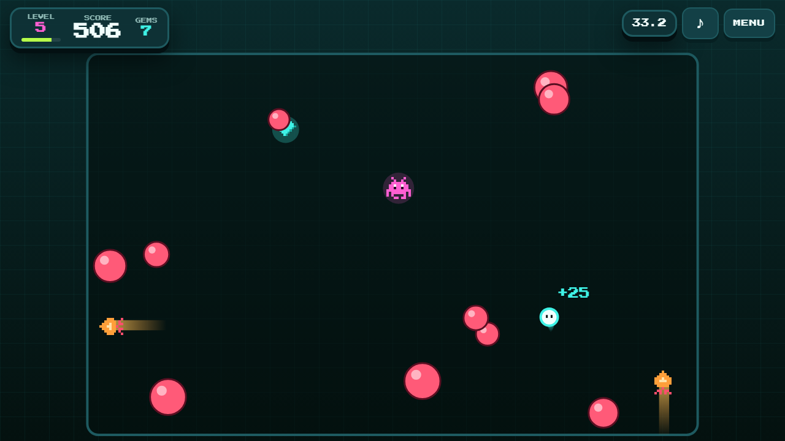

# Blip Panic

Grab the gems. Dodge everything else.

A fast arcade dodge game in one HTML file. Steer your blip around the arena, collect 💎 gems and survive as the levels get harder: bubbles from level 1, zoomers from level 3, chasers from level 5.



## Play
Open `index.html` in any browser, or play the hosted version on GitHub Pages.

## Controls
| Device | How |
| --- | --- |
| Mouse | The blip follows your cursor |
| Phone / tablet | Left thumb anywhere = joystick (landscape) |
| Keyboard | Arrow keys or WASD |
| Controller | Left stick, A to select, Start to pause |
| Any | Esc / P pause, M mute |

## Scoring
+10 per second, +25 per gem, +5 for a close call. Gems buy skins and revives. Progress is saved in the browser.

## Build
```
python build.py
```
Makes `dist/blip-panic-itch.zip` for itch.io and other HTML5 game sites.
